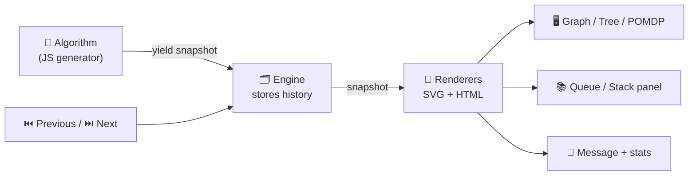

<div align="center">

# 🧭 AlgoScope

### *Watch AI search algorithms think, one step at a time.*


**🎓 Built for students &nbsp;•&nbsp; 🔬 Real algorithm logic &nbsp;•&nbsp; 🎬 Step-by-step visual execution**

[✨ Features](#-features) · [🧠 Algorithms](#-algorithms-covered) · [🕹️ How to use](#️-how-to-use-it) · [🛠️ Custom graphs](#️-build-your-own-graph) · [⚙️ Under the hood](#️-how-it-works-internally) · [🚀 Run & deploy](#-run-locally)

</div>

---

## 🎯 Purpose

Search algorithms are a core topic in undergraduate Computer Science and AI, yet they are usually taught with static diagrams and pseudocode. Students memorize the steps without seeing *why* a node was chosen next.

**AlgoScope turns every algorithm into a live simulation:**

| 🖼️ You see | 📦 You learn |
|---|---|
| A **graph / game tree** with colour-coded node states | How the search explores the space |
| A **data structure panel** with every push and pop | What the queue, stack or priority queue holds right now |
| A **plain-language message** per step | *Why* the algorithm made that choice |

---

## 💡 Why this project exists

- 👀 **See, don't just read.** Watching a queue grow and shrink explains BFS better than a paragraph.
- 🎯 **Accuracy over decoration.** No hardcoded animations. Every frame is a snapshot of a real execution, so the display can never disagree with the algorithm.
- ⚖️ **Compare behaviour.** Run two algorithms on the same graph and see the trade-offs with real numbers.
- 📦 **Zero setup.** The entire app is one HTML file: no install, no build, no server.

---

## ✨ Features

| | Area | What you get |
|---|---|---|
| 🎨 | **Visualization** | Graph canvas, game-tree view and POMDP scene with distinct colours for unvisited, current, frontier, visited, path, goal, start and pruned |
| 📚 | **Data structure visuals** | Queue (BFS), stack (DFS), priority queues with keys (Greedy, A\*, Dijkstra), candidate edges (Prim), recursion call stack (Minimax, Alpha-Beta). 🟥 popped, 🟩 pushed |
| ⏯️ | **Execution controls** | Start, Pause, Resume, Replay, Next, **Previous** (full history stored), Reset, speed slider |
| ✏️ | **Graph editor** | Add, move, delete nodes and edges · set start and goal · edit weights and heuristics · random graph · auto admissible heuristic · built-in example |
| 📥 | **Custom graphs** | Import and export graphs as simple text |
| 🌳 | **Game tree editor** | Edit leaf utilities or randomize them |
| 📖 | **Explanations** | Definition, data structure, pros, cons, time and space complexity, completeness, optimality, real-world uses |
| 📊 | **Live statistics** | Expanded, discovered, max frontier, path cost, leaves evaluated, pruned nodes, all counted from the real run |
| 🆚 | **Comparison** | Two algorithms on the same graph: table, bar charts, optimality check, final states side by side |
| 🧪 | **Practice mode** | Beginner, Intermediate and Advanced quizzes with explanations. "Which node is expanded next?" questions are generated from real runs on *your* graph |
| 📄 | **Report** | One-click report: final-state image, result, statistics, algorithm summary and full step log |
| 🌗 | **UI** | Dark and light themes, responsive on desktop, tablet and mobile |

> 🖼️ **Screenshots:** add your own images here, for example `docs/astar.png` and `docs/alphabeta.png`, then show them with ``.

---

## 🧠 Algorithms covered

| | Category | Algorithm | What the visualization shows |
|---|---|---|---|
| 🌊 | Uninformed | **Breadth-First Search** | FIFO queue, level-by-level rings, final path |
| 🕳️ | Uninformed | **Depth-First Search** | LIFO stack, diving deep, backtracking |
| 🎯 | Informed | **Greedy Best-First** | Priority queue ordered by h(n) |
| ⭐ | Informed | **A\* Search** | g(n), h(n), f(n) on every node, queue ordered by f(n) |
| 🛣️ | Graph optimization | **Dijkstra** | Cumulative distances, edge relaxation, queue changes |
| 🌲 | Graph optimization | **Prim's MST** | Growing tree, candidate edges, total weight |
| ♟️ | Adversarial | **Minimax** | MAX / MIN levels, utilities flowing upward, call stack |
| ✂️ | Adversarial | **Alpha-Beta Pruning** | Live α and β, pruned branches, reason for each cut |
| 🎲 | Uncertainty | **Stochastic Search** | Slip probability, landing probability per neighbour, repeated runs |
| 🐯 | Uncertainty | **POMDP (Tiger problem)** | Hidden true state vs the agent's belief, Bayes updates |

> [!IMPORTANT]
> **Dijkstra vs Prim:** Dijkstra finds *shortest paths from a source*. Prim builds a *minimum spanning tree* connecting all nodes at minimum total weight. They solve different problems, and the app keeps them separate.

<details>
<summary><b>📐 Algorithm cheat sheet (complexity, completeness, optimality)</b></summary>

| Algorithm | Time | Space | Complete? | Optimal? |
|---|---|---|---|---|
| BFS | O(V+E) | O(V) | Yes (finite graphs) | Only if all edges cost the same |
| DFS | O(V+E) | O(V) | Yes with a visited set (finite) | No |
| Greedy | O(b^m) worst | O(b^m) | Yes with a visited set (finite) | No |
| A\* | O(b^d) worst | O(b^d) | Yes | Yes, if h is admissible |
| Dijkstra | O((V+E) log V) | O(V) | Yes | Yes, for non-negative weights |
| Prim | O(E log V) | O(V+E) | Spans the start's component | Yes (minimum total weight) |
| Minimax | O(b^d) | O(b·d) | Yes (finite tree) | Yes vs an optimal opponent |
| Alpha-Beta | O(b^d) worst, O(b^(d/2)) best | O(b·d) | Yes | Same value as Minimax |
| Stochastic | Varies | O(path) | Not guaranteed | No |
| POMDP | PSPACE-hard (exact) | O(\|S\|) per belief update | Depends on policy | Depends on policy |

</details>

---

## 🕹️ How to use it

1. 📌 Pick an algorithm in the left sidebar.
2. ✏️ *(Optional)* Edit the graph or tree with the tool buttons.
3. ▶️ Press **Start** for automatic mode, or **Next** for step-by-step mode. **Previous** walks back through stored history.
4. 👀 Watch the graph on the left and the data structure on the right. Read **"What just happened"** for the reason behind each step.
5. 📊 Open **Statistics, colour legend and explanation** under the canvas for numbers and the full algorithm write-up.
6. 🆚 Try **Compare algorithms** and 🧪 **Practice and quiz**.
7. 📄 Click **Generate report** to summarize the current run.

### 🧰 Graph editor tools

| Tool | Action |
|---|---|
| 🖐️ Move | Drag nodes |
| ➕ Add node | Click empty canvas |
| 🔗 Connect | Click two nodes (random weight) |
| 🗑️ Delete | Click a node or edge |
| 🚩 Set start / 🏁 Set goal | Click a node |
| ⚖️ Weight + / − | Click an edge |
| 🧭 h + / h − | Click a node to change its heuristic |

---

## 🛠️ Build your own graph

Use the tools above, **or** paste a graph as text via **Import / export graph**. One item per line:

```text
# edge: node node weight
A B 4
A C 2
B D 5
C D 8

# heuristic values (optional, used by Greedy and A*)
h A 6
h B 4
h C 5
h D 0

# optional positions (otherwise nodes are placed on a circle)
pos A 100 250
pos D 700 250

start A
goal D
```

| Line | Meaning |
|---|---|
| `A B 4` | Undirected edge A–B with weight 4 |
| `h A 6` | Heuristic of A is 6 |
| `pos A 100 250` | Canvas position (x 30–770, y 40–460) |
| `start A` / `goal D` | Start and goal (defaults: first and last node) |
| `# text` | Comment, ignored |

> [!TIP]
> Open **Import / export graph** at any time to see your current graph in this format. Copy it to save or share.

> [!NOTE]
> Use 2 to 26 nodes, and avoid naming a node `h`, `pos`, `start` or `goal`. For A\* to be optimal, the heuristic must be **admissible** (never overestimate the true remaining cost). The **Auto h** button generates admissible values for you.

---

## ⚙️ How it works internally

The core idea: **separate the algorithm from the display.**



1. 🧮 **Algorithms are generators.** At each meaningful point they `yield` a snapshot: current node, frontier in order, visited set, g/h/f labels, last popped and pushed nodes, statistics and a plain-language message.
2. 🗂️ **The engine stores history.** The controller pulls one snapshot at a time and keeps them all. That is what makes **Previous**, pause, slow-down and replay work without recomputing.
3. 🎨 **Renderers only draw.** Separate functions turn a snapshot into SVG (graph, tree, POMDP scene) and HTML boxes (queue and stack). They contain no algorithm logic.
4. 📊 **Statistics come from the run.** Counters increase inside the algorithm itself. The comparison view runs each algorithm to completion on the same graph and averages run time over 30 runs.
5. 🧪 **Quiz questions use real executions.** The correct answer to "which node is expanded next?" is whatever the algorithm actually did next.

<details>
<summary><b>🔍 Key algorithm details</b></summary>

- **BFS** discovers a node when first seen and uses a FIFO queue.
- **DFS** uses a LIFO stack, may hold duplicates, and skips already-expanded entries when popped (that skip is the backtracking).
- **Greedy** picks the frontier node with the smallest h(n).
- **A\*** picks the smallest f(n) = g(n) + h(n), lowers g(n) when a cheaper path appears, and reopens a node if a cheaper route is found later.
- **Dijkstra** runs until every reachable node is settled, then shows the shortest path to the goal.
- **Prim** repeatedly adds the cheapest edge that connects a new node to the tree.
- **Minimax** evaluates recursively with MAX and MIN levels.
- **Alpha-Beta** passes α and β down the recursion and prunes the remaining children when α ≥ β, explaining the reason for MAX and MIN nodes.
- **Stochastic search** aims for the neighbour with the lowest weight plus heuristic but, with probability p, slips to a uniformly random neighbour. Landing probability: (1 − p) + p/n for the intended neighbour, p/n for the others.
- **POMDP (Tiger)** keeps a belief b = P(tiger left). After listening (85% accurate) it applies Bayes' rule. A threshold policy opens a door once the belief reaches 0.95 or 0.05.

</details>

---

## 🗂️ Project structure

```text
📦 algoscope
 ├── 📄 index.html   ← the whole app (HTML + CSS + JavaScript)
 └── 📘 README.md    ← you are here
```

> [!NOTE]
> Rename `search-lab.html` to `index.html` when adding it to the repository, so GitHub Pages and most hosts serve it automatically.

<details>
<summary><b>🧱 Inside index.html</b></summary>

| Section | Contents |
|---|---|
| 🎨 CSS | Light and dark colour tokens, layout, node and edge states, queue and stack styling, report styling |
| 📚 `A` object | Educational text and complexity data for all ten algorithms |
| 🕸️ Graph model | Default example, random graph generator, auto heuristic, game-tree builder |
| 🧮 Algorithms | `gAlgo` (BFS, DFS, Greedy, A\*, Dijkstra), `prim`, `mmAlgo` (Minimax and Alpha-Beta), `stoch`, `pomdp` |
| 🖌️ Drawing | `dGraph`, `dTree`, `dPom`, `qviz` |
| 🎛️ Engine | History, play, pause, next, previous, reset |
| 🪟 Views | Visualizer, comparison, practice and quiz, report |
| 🔌 Wiring | Buttons, canvas pointer events, import and export parser |

</details>

---

## 🚀 Run locally

No installation needed.

**Option 1: just open it**

1. Download or clone the repository.
2. Double-click `index.html`.

**Option 2: tiny local server (optional)**

```bash
git clone <your-repository-url>
cd <your-repository-folder>
python3 -m http.server 8000
```

Open `http://localhost:8000` in your browser.

> 🌐 Internet is only used to load the *Sora* and *JetBrains Mono* fonts from Google Fonts. Without it, the app falls back to system fonts and works the same.

---

## ☁️ Deploy

**GitHub Pages**

1. Push the repository with `index.html` in the root.
2. Go to **Settings → Pages**.
3. Under **Build and deployment**, choose **Deploy from a branch**, select `main` and `/ (root)`, then save.
4. After about a minute: `https://<your-username>.github.io/<repository-name>/`

**Netlify / Vercel:** drag and drop the folder or connect the repository. No build command; the publish directory is the repository root.

> [!WARNING]
> **Report download:** the "Download report" button relies on a download feature that exists only when the page is hosted inside Claude. On GitHub Pages and other hosts it shows "Download unavailable here: use Print". Use **Print / save as PDF** in the report instead.

---

## 🧰 Technology choices

| Choice | Why |
|---|---|
| 🧱 Plain HTML, CSS, JavaScript in one file | Zero setup, easy to share, host and read |
| 🔁 JavaScript generators | Pause an algorithm at every step; keep logic separate from display |
| 📐 SVG | Crisp at every size, styled with CSS variables |
| 🌗 CSS variables | Dark and light themes from one set of tokens |

The original brief suggested React, TypeScript, Tailwind and Framer Motion. This version uses no framework so it works as a single file. The architecture (generators separate from renderers) ports directly to React and TypeScript.

---

## ✅ Correctness and honesty notes

- 🔢 Every statistic is computed from the actual run. Nothing is invented.
- 📏 Completeness and optimality statements state their assumptions (A\* needs an admissible heuristic, Dijkstra needs non-negative weights, BFS is optimal only for equal edge costs).
- 🎯 Greedy search deliberately returns a non-optimal path on the built-in example (**cost 14 vs the optimal 11**), so students see why ignoring cost-so-far is risky.
- ⏱️ Run times are measured in the browser and are only a rough relative guide on small graphs.
- 🧪 Automated tests are not included yet. The algorithms follow the standard textbook definitions, but verify them against your own known examples.

---

## ⚠️ Known limitations

- 🆚 Comparison covers BFS, DFS, Greedy, A\* and Dijkstra only.
- 🌳 The game tree has a fixed shape (binary, depth 3, eight leaves); only leaf values are editable.
- 🐯 POMDP is the classic Tiger problem with a threshold policy, not a general solver.
- 🎞️ Nodes are redrawn each step, so there are no smooth colour transitions.
- 🎲 A new stochastic or POMDP run replaces the previous random run.
- ↔️ Graphs are undirected.

---

## 🔮 Future improvements

- [ ] 🧪 Unit tests against known textbook results
- [ ] ➡️ Directed graphs and Bellman-Ford (negative weights)
- [ ] 🌳 Larger, editable game trees and move-ordering experiments
- [ ] 🧱 Grid and maze mode
- [ ] 🐯 General POMDP editor with custom probabilities
- [ ] 🎞️ Smooth animated transitions
- [ ] 💾 Normal browser download for the report on self-hosted sites
- [ ] ⚛️ React and TypeScript port

---

<div align="center">

## 👨‍💻 Author

**Akash Kumar**
*AI Search Algorithms Project*

Made with ❤️, curiosity and a lot of nodes.

⭐ If AlgoScope helped you understand search algorithms, give the repository a star!

</div>
